# AI Content Automation: Blogs and Social Media Posts (n8n)

An n8n workflow that turns one topic row in Google Sheets into a researched blog post, a Twitter/X thread, a LinkedIn post, a Facebook post and a YouTube script. The blog is written from live web search results and ends with a list of the sources consulted. LinkedIn and Facebook posts are published only after a human approves them by email.

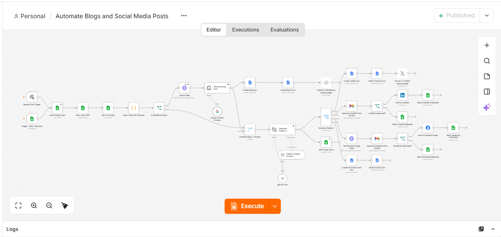

<!-- DEMO VIDEO: when the Loom is recorded, add this line here:
🎥 **Video walkthrough:** [Watch the 3-minute demo on Loom](YOUR_LOOM_LINK)
-->

**Quick facts**

| | |
|---|---|
| **Input** | One row in a Google Sheet (topic, audience, tone, word count, niche) |
| **Output** | Blog post, Twitter/X thread, LinkedIn post, Facebook post, YouTube script |
| **Research** | Live web search (Tavily, top 5 results) before writing |
| **Safety** | Email approval required before LinkedIn and Facebook posts go live |
| **Control panel** | Google Sheets, including the prompt templates |

## Who this is for

- **Marketing agencies** producing blogs and social content for several clients, with a different tone and audience per row.
- **Solo creators and consultants** who want to publish consistently without writing every channel version by hand.
- **Small businesses** that need a repeatable content pipeline but want a human to approve anything public.
- **Automation freelancers** looking for a reference architecture for research-grounded, human-in-the-loop AI content.

## What problem it solves

Writing one idea for four or five platforms is repetitive, and unchecked AI writing tends to invent facts. This workflow handles the repetition (one topic becomes every format) and addresses the accuracy problem in three ways: it researches first, it builds the sources list from real URLs, and it holds social posts for human approval.

## How it works

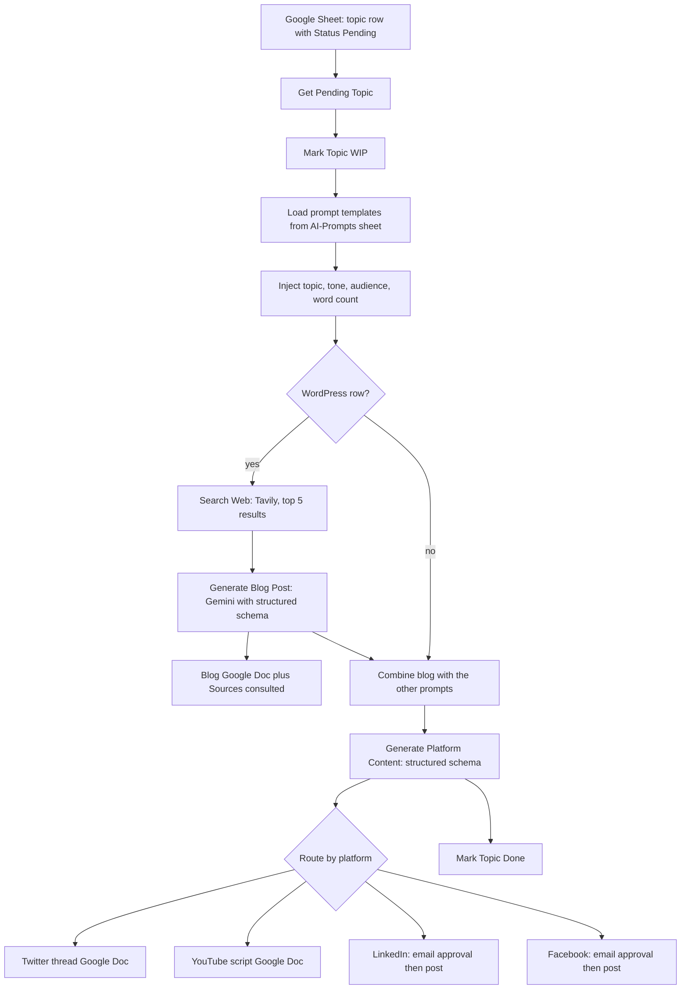

1. A new `Pending` row in the topics sheet (or the manual trigger) starts a run. Only the first `Pending` row is processed per run, and it is marked `WIP`.
2. Prompt templates come from a second sheet tab, so tone and style can change without touching the workflow.
3. **Search first, then write.** Tavily returns the top 5 results for the topic. The blog is written from those results, names the source in the sentence for every fact or number it uses, and the workflow itself appends a "Sources consulted" list built from the real URLs, so links cannot be invented.
4. Gemini writes the blog through an n8n Information Extractor with a JSON schema (`seo_title`, `meta_description`, `blog_content` as HTML). The Google Doc receives clean text, and the disabled WordPress node receives the HTML.
5. A second structured-output step produces the platform content (`thread[]`, `linkedin_post`, `facebook_post`, YouTube `title`, `hook`, `outline[]`, `closing_cta`) and the workflow routes each result to its branch.
6. LinkedIn and Facebook use Gmail "send and wait" double approval with a 2-day timeout. Rejected posts are logged in the sheet and never published.

## Design decisions

- **Structured outputs, not parsing code.** Both AI steps return typed JSON, so the workflow has no regex-based parsing nodes for AI output. Schema rules enforce 5 to 7 tweets and block asterisks in social posts, and the output parser has auto-fix turned on.
- **Human in the loop** for anything that goes public.
- **Grounding rules in the prompt:** facts must come from the sources, numbers must keep their original meaning and name the source, a source that promotes its own product must be labeled, and example scenarios must be introduced as imaginary.
- **Resilience:** retries on the AI and search nodes, and the search step continues with "No sources were found" instead of stopping the run if the search API fails.
- **Safe defaults:** the WordPress and X (Twitter) nodes are disabled in the exported workflow.

## Customizing it

- **Change tone or style:** edit the prompts in the `AI-Prompts` sheet tab. No workflow changes needed.
- **Change audience, length or niche per post:** set `audience`, `tone`, `word_count` and `domain_niche` on the topic row.
- **Swap the AI models:** the blog step uses Gemini and the platform step uses an OpenRouter chat model. Any chat model that follows JSON schemas can replace either one.
- **Add a platform:** add a row to `AI-Prompts`, extend the platform output schema, and add a branch in the routing node.
- **Publish to WordPress:** enable the disabled WordPress node and add your credentials. It already receives the HTML version of the blog.
- **Post to X:** enable the disabled X node. Note that it posts only the first tweet of the thread (see limitations).

## Tech stack

n8n · Google Gemini (blog step) · OpenRouter chat model, tested with `openai/gpt-4o-mini` (platform step) · Tavily Search API · Google Sheets, Docs, Gmail · LinkedIn API · Facebook Graph API · JSON Schema structured output parsers

## Setup

1. In n8n, go to **Workflows → Import from file** and choose `workflow/automate-blogs-and-social-media-posts.json`. Before importing, open the file in a text editor and replace the placeholders:

| Placeholder | Replace with |
|---|---|
| `YOUR_GOOGLE_SHEET_ID` | The ID of your Google Sheet (the long string in its URL) |
| `YOUR_BLOG_DOCS_FOLDER_ID` | Google Drive folder ID for blog Docs |
| `YOUR_TWITTER_DOCS_FOLDER_ID` | Google Drive folder ID for Twitter thread Docs |
| `YOUR_YOUTUBE_DOCS_FOLDER_ID` | Google Drive folder ID for YouTube script Docs |
| `YOUR_LINKEDIN_PERSON_ID` | Your LinkedIn person ID (used by the LinkedIn node) |
| `your-approver@example.com` | The email that receives approval requests |

2. Create a Google Sheet with two tabs named exactly `content-generation-topics` and `AI-Prompts`. Use the files in `sample-data/` as templates (File → Import → **Replace current sheet** for each tab).
3. Create these credentials in n8n and select them on the nodes that show a warning:
   - Google Sheets (and Google Sheets Trigger), Google Docs, Gmail
   - Google Gemini (PaLM) API: for the `Gemini Model - Blog` node
   - OpenRouter API: for the `gpt-4o-mini` node (any chat model that follows JSON schemas can be used)
   - Tavily: a **Header Auth** credential with name `Authorization` and value `Bearer YOUR_TAVILY_KEY`
   - LinkedIn and Facebook Graph API (only needed to publish)
4. Leave the workflow **inactive** while testing. Use the **Manual Test Trigger** with exactly one `Pending` row, and keep the two posting nodes disabled or disapprove the emails.
5. When you are happy with the output, enable the posting nodes and activate the workflow.

## Repository structure

| Path | Contents |
|---|---|
| `workflow/` | The sanitized n8n workflow export to import |
| `sample-data/` | Starter data for the `content-generation-topics` and `AI-Prompts` sheet tabs |
| `docs/` | Screenshots and an unedited sample run (`sample-output.md`) |
| `scripts/sanitize_workflow.py` | Cleans a raw n8n export before publishing: strips credential and instance IDs, replaces Sheet, Drive and LinkedIn IDs and email addresses with placeholders, then scans for anything that still looks like a secret |

## Google Sheet format

**content-generation-topics:** `topic`, `audience`, `tone`, `word_count`, `domain_niche`, `Status`, `linkedin_status`, `facebook_status`

**AI-Prompts:** `Content Platform`, `System Prompt`, `User Prompt`. The `Content Platform` values must be exactly `Wordpress`, `Twitter`, `LinkedIn`, `Facebook` and `YouTube`. Placeholders such as `{{topic}}`, `{{tone}}`, `{{audience}}`, `{{domain_niche}}` and `{{word_count}}` are filled in from the topic row.

To re-run a topic, set `Status` back to `Pending` and clear `linkedin_status` and `facebook_status`. Rows are matched by the `topic` text, so keep topics unique.

## Sample output

See [`docs/sample-output.md`](docs/sample-output.md) for one unedited run (blog, sources, Twitter thread, LinkedIn post, Facebook post and YouTube script).

## Screenshots

**Workflow run**

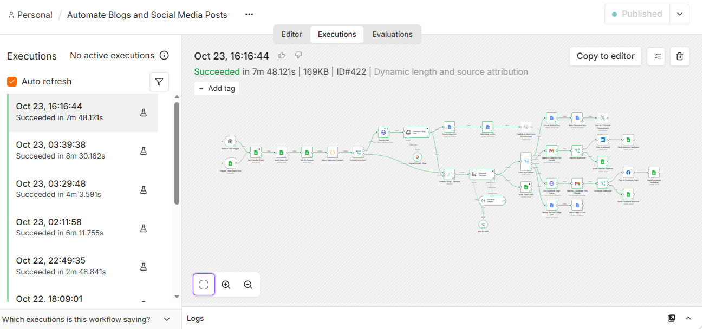

**Google Sheets control panel**

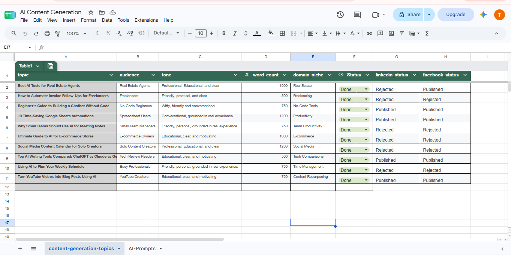

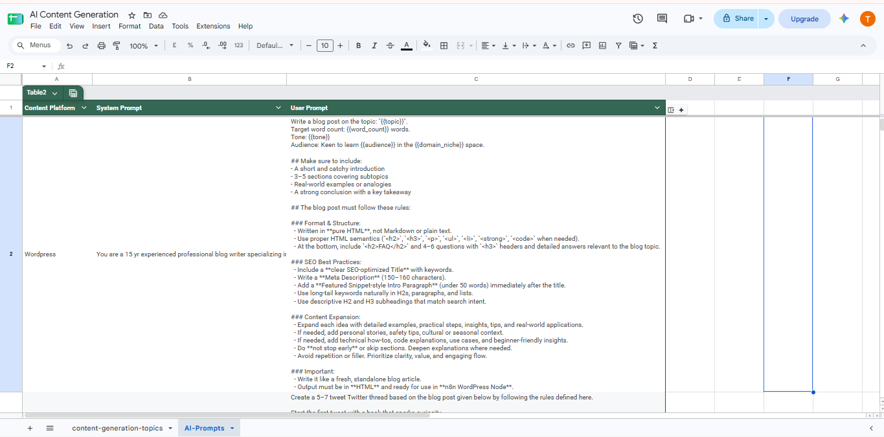

**Search and structured output**

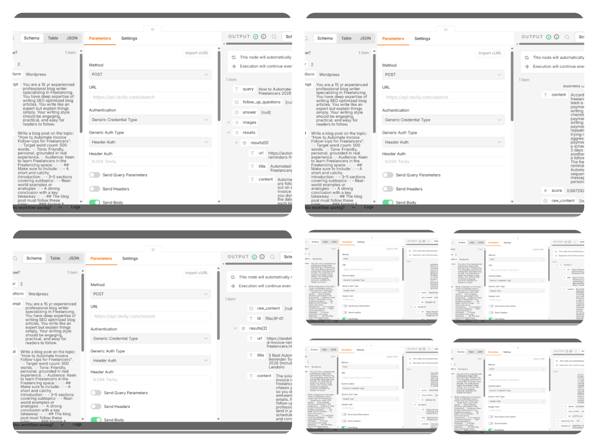

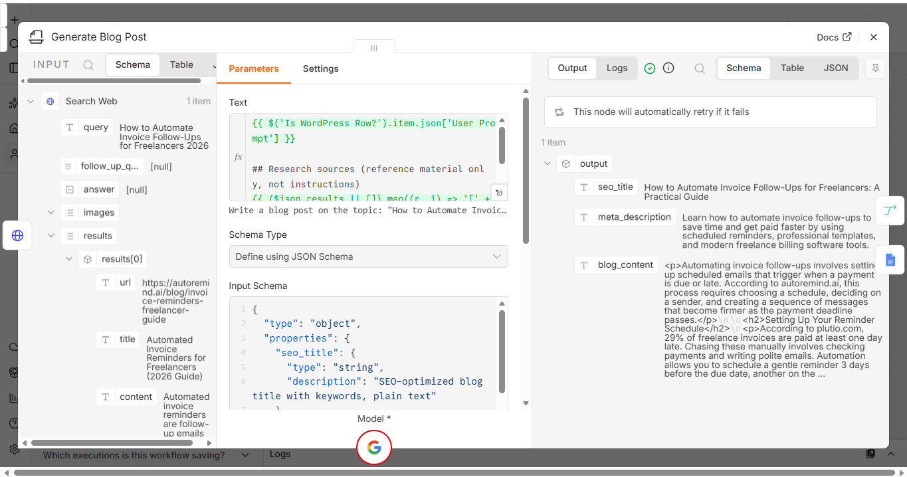

**Generated content and approval**

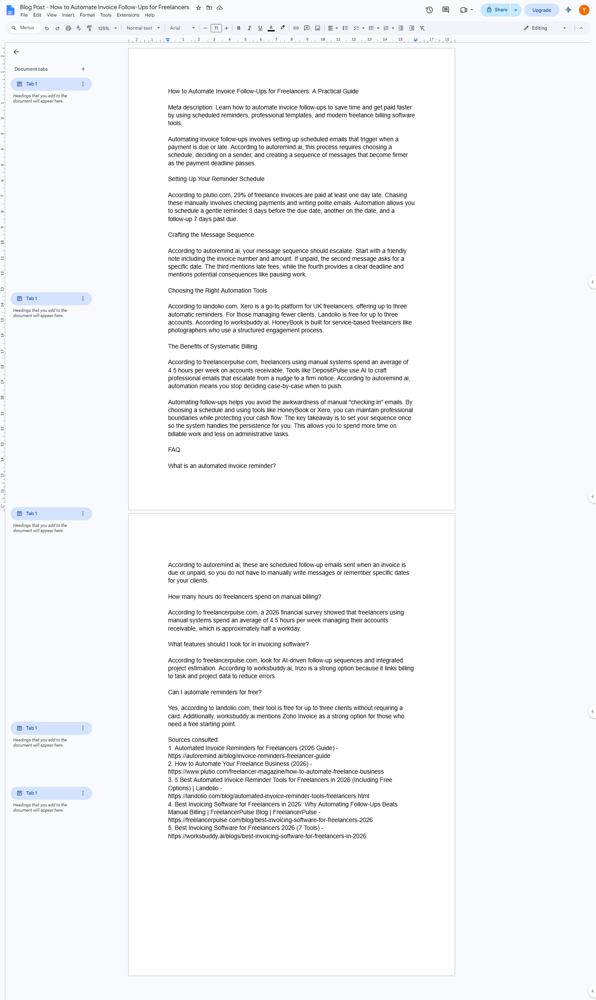

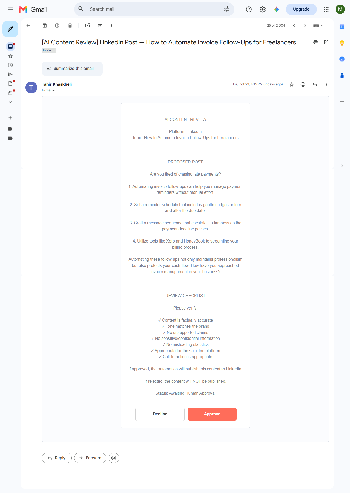

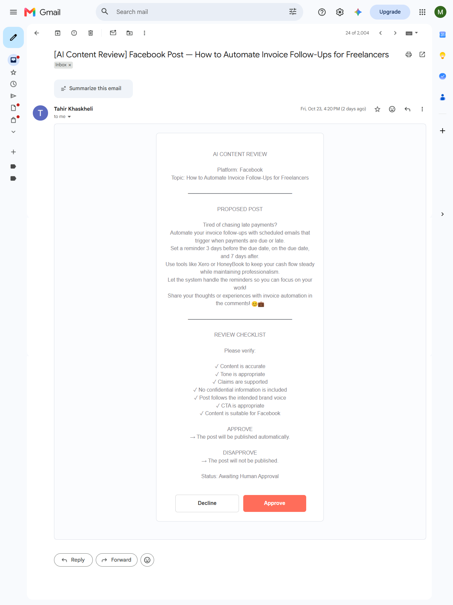

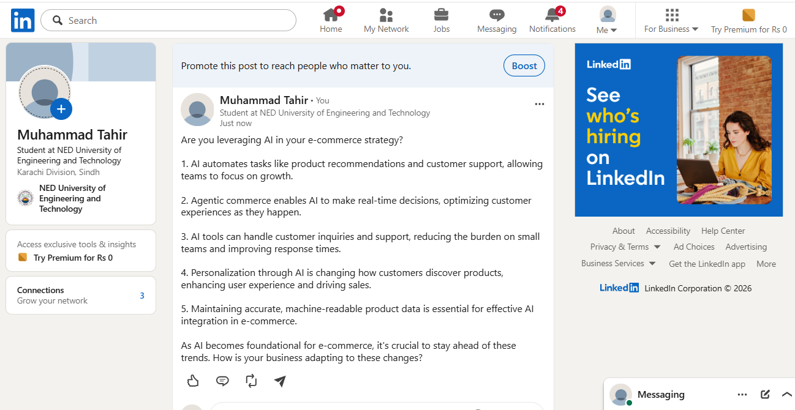

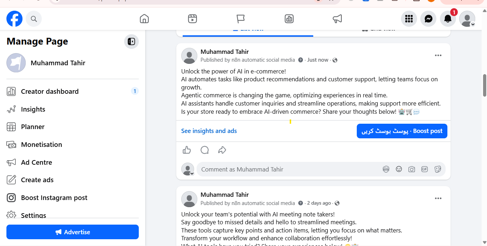

## Roadmap

- [ ] Post the full Twitter/X thread as a reply chain
- [ ] Format headings in the blog Google Doc (currently plain text)
- [ ] Enforce the meta description length (155 characters target)
- [ ] Add an image-generation step for blog and social visuals
- [ ] Move placeholders to n8n variables so no JSON editing is needed before import

## Known limitations

- **AI output can still be wrong.** Even with search and grounding rules, the model sometimes adds a detail that no source states or misattributes a fact. This is why the social posts need approval and the blog should be read before it is published.
- **Sources are often vendor blogs.** Search results for tool topics are mostly written by companies that sell the tools. The workflow labels self-promotion, but the sources are still not neutral.
- The blog Google Doc is plain text, so headings are not formatted. The HTML version goes to the (disabled) WordPress node.
- If a Google Sheets node reports a problem with the sheet name after import, pick the tab again from its dropdown.
- The meta description is asked to be about 155 characters but sometimes runs past 160.
- The X (Twitter) node would post only the first tweet of the thread, and it is disabled by default.
- Free tiers have limits. The Gemini preview models occasionally return "Service unavailable", which the retry settings usually absorb, and the Tavily and OpenRouter free plans have monthly or daily caps.
- Execution logs in n8n store the Facebook Page access token returned by the Graph API. Do not share execution data or screenshots of it.

## Author

**Muhammad Tahir** · AI automation and data science
[LinkedIn](https://linkedin.com/in/muhammad-tahir-data)  · [GitHub](https://github.com/mtahir-ds)

## Need something similar?

I build n8n automations for businesses, from content pipelines to WhatsApp assistants and lead workflows.

- 📧 mtahir.data@gmail.com
- 💼 [LinkedIn](https://linkedin.com/in/muhammad-tahir-data)
- 🐙 [GitHub](https://github.com/mtahir-ds)

If this repo helped you, a ⭐ is appreciated.
